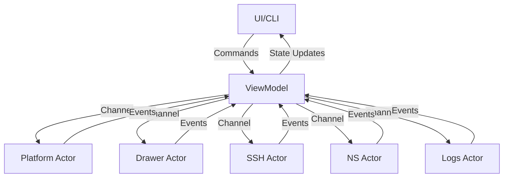

# Dure Installer Architecture (SudoLang v2.0)

> Distributed e-commerce platform installer — GCP VM automation, DNS, SSH, store mgmt.
> Pure Rust, cross-platform (Desktop/Android/WASM), egui Material3 UI, smol async.

## System Properties

```sudo
Platform {
  language: Rust nightly
  async_runtime: smol (no tokio, no OpenSSL)
  ui: egui 0.33 + eframe (Material3)
  targets: [Linux, macOS, Windows, Android, WASM]
  architecture: Layered MVVM (UI → ViewModel → Calc/Api)
  storage: SQLite (Diesel 2.3), PostgreSQL support
  security: attestation (GitHub Sigstore), rustls, russh, keyring
}
```

## Architecture Layers

```sudo
interface Architecture {
  constraint: Uni-directional flow: UI/CLI → ViewModel → Calc → Api
  constraint: Platform abstraction via #[cfg(...)]
  constraint: GUI optional (--no-default-features for headless)
  constraint: Profile-scoped operations via ProfileContext
}

Layers {
  Entry {
    main.rs               // Desktop (eframe)
    main_android.rs       // Android (native-activity)
    main_wasm.rs          // WASM
    lib.rs                // Library exports
  }

  UI {
    dure.rs               // DureApp (eframe root)
    ui_tabs/              // Platform, SSH, NS, Site, Products, Orders, Settings
    ui_dlg/               // Dialogs (ProfileLogin, Settings, About, DbDebugger)
    ui_components/        // Reusable components
    constraint: feature-gated "gui"
  }

  ViewModel {
    // Actor-based MVVM coordinator
    mod.rs                // ViewModel struct, unified event bus
    common.rs             // Events, commands, state
    platform/actor.rs     // GCP VM actor
    platform/drawer_actor.rs // Billing drawer actor
    ssh/actor.rs          // SSH actor
    ns/actor.rs           // DNS actor
    logs/actor.rs         // Logs actor
    runtime.rs            // smol executor mgmt
    io.rs                 // I/O operations
    
    constraint: Actors communicate via smol channels
    constraint: Unified event receiver for UI/CLI
    constraint: Optional egui::Context for GUI mode
    constraint: ProfileContext for profile-aware ops
  }

  Calc {
    // Business logic (pure Rust)
    db.rs                 // Profile-scoped DB operations (Diesel)
    profile.rs            // ProfileContext, auth
    crypt.rs              // Encryption, key derivation
    keyring.rs            // Secure key storage (platform-specific)
    gcp.rs                // GCP orchestration
    dns.rs                // DNS orchestration
    ssh.rs                // SSH operations, russh
    ns.rs                 // Nameserver mgmt
    site.rs               // Site mgmt
    audit.rs              // Audit logs
    session.rs            // Session mgmt
    docker.rs             // Docker operations
    mycart.rs             // Mycart backend integration
    acme.rs               // ACME protocol (Let's Encrypt)
  }

  Api {
    // External API integrations
    gcp/ {
      compute.rs          // VM instances
      billing.rs          // Cost tracking
      dns.rs              // Cloud DNS
      oauth.rs            // OAuth2
      resourcemanager.rs  // Projects
      serviceusage.rs     // API enablement
      compute_addresses.rs // Static IPs
      publicca.rs         // TLS certs
    }
    ns_cloudflare.rs      // Cloudflare DNS
    ns_duckdns.rs         // DuckDNS
    ns_porkbun.rs         // Porkbun
    ns_gcp.rs             // GCP DNS
    github.rs             // Attestation, releases
    mycart.rs             // Mycart API client
    desktop.rs            // Desktop-specific utils
    ehttp_cache.rs        // HTTP caching
  }

  CLI {
    // Headless command implementations
    commands/ {
      platform_vm.rs      // Platform CLI
      ssh.rs              // SSH CLI
      ns.rs               // DNS CLI
      site.rs             // Site CLI
      audit.rs            // Audit CLI
      crypt.rs            // Crypto CLI
      keyring.rs          // Keyring CLI
    }
    constraint: Reuses ViewModel actors
    constraint: Profile-aware via ProfileContext
  }
}
```

## Actor Communication Pattern



```sudo
// Actor pattern
Actor {
  constraint: Each actor = dedicated smol channel
  constraint: Commands → Actor, Events → ViewModel
  constraint: Actors operate on ProfileContext (profile-scoped state)
}

ActorLifecycle {
  spawn(cmd_rx: Receiver<Command>, event_tx: Sender<Event>, profile: ProfileContext) {
    constraint: Run forever in smol task
    constraint: Process commands, emit events
    constraint: Graceful shutdown on channel close
  }
}

// Example: Platform Actor
PlatformActor {
  commands: [
    ListVms(region) => query GCP VMs |> emit VmsListed(vms)
    CreateVm(spec) => provision GCP VM |> emit VmCreated(vm)
    DeleteVm(id) => destroy GCP VM |> emit VmDeleted(id)
  ]
  
  constraint: All DB ops scoped to ProfileContext
  constraint: GCP API calls via api::gcp
}
```

## Profile-Aware Operations

```sudo
ProfileContext {
  store_id: String       // Unique store identifier
  user_email: String     // Owner email
  constraint: All DB queries filtered by store_id
  constraint: All file ops use profile-specific paths
}

ProfileScoping {
  Database {
    // Diesel queries with profile filter
    query_profiles(ctx) => SELECT * FROM profiles WHERE store_id = ctx.store_id
    query_vms(ctx) => SELECT * FROM vms WHERE profile_id IN (...)
  }
  
  FileSystem {
    config_path(ctx) => ~/.config/dure/{store_id}/config.toml
    data_dir(ctx) => ~/.local/share/dure/{store_id}/
  }
  
  Actors {
    constraint: All actors receive ProfileContext at spawn
    constraint: Operations isolated per profile
  }
}
```

## Key Technologies

```sudo
Stack {
  UI: egui 0.33, eframe, egui_material3
  Async: smol 2.0, async-channel
  Database: Diesel 2.3 (SQLite + PostgreSQL)
  HTTP: ureq 2.12 (blocking), ehttp (async for WASM)
  TLS: rustls 0.23 (no OpenSSL)
  SSH: russh 0.45 (pure Rust)
  Crypto: ring, ed25519-dalek, x25519-dalek
  Serialization: serde, toml, serde_json
  
  constraint: No OpenSSL anywhere
  constraint: Pure Rust crypto/TLS/SSH stack
}

PlatformSpecific {
  Desktop: tray-icon, dotenvy, keyring
  Android: ndk-context, jni, android-activity
  WASM: wasm-bindgen, web-sys, sqlite-wasm-rs
}
```

## Build Profiles

```sudo
Profiles {
  dev: unoptimized, fast compile
  dev-release: LTO=thin, opt-level=2, balanced
  release: LTO=fat, opt-level=3, strip, size-optimized
  
  constraint: Incremental=false for release profiles
}

BuildCommands {
  Desktop: cargo build [--profile <profile>]
  Android: cd mobile && ./build.sh
  WASM: wasm-pack build --target web
  Headless: cargo build --no-default-features
}
```

## Security Model

```sudo
Security {
  Attestation {
    // GitHub Sigstore verification
    verify_binary(path) => check Sigstore signature |> validate cert
    constraint: All binary downloads verified
  }
  
  Encryption {
    keyring: platform-specific secure storage (keychain/secret-service/DPAPI)
    at_rest: SQLCipher (AES-256)
    in_transit: rustls (TLS 1.3)
  }
  
  SSH {
    keys: Ed25519 (modern, secure)
    protocol: russh (pure Rust, audited)
    constraint: No password auth (keys only)
  }
  
  Secrets {
    constraint: All secrets in keyring (never plaintext)
    constraint: GCP OAuth tokens stored securely
    constraint: SSH keys encrypted at rest
  }
}
```

## Data Flow Examples

```sudo
// VM Creation Flow
CreateVm(spec) {
  UI → ViewModel.send_command(PlatformCommand::CreateVm(spec))
  ViewModel → platform_tx.send(cmd)
  PlatformActor.receive(cmd) → {
    calc::gcp::provision_vm(spec, ctx.profile)
    api::gcp::compute::create_instance(spec)
    calc::db::insert_vm(vm, ctx.profile)
    emit VmCreated(vm)
  }
  ViewModel.receive(VmCreated(vm)) → {
    state.active_operations.remove("create_vm")
    #[cfg(feature = "gui")] egui_ctx.request_repaint()
  }
  UI.update() → display new VM
}

// DNS Update Flow
UpdateDns(domain, records) {
  CLI → ViewModel.send_command(NsCommand::UpdateRecords(domain, records))
  NsActor → {
    calc::ns::resolve_provider(domain, ctx.profile)
    match provider {
      Cloudflare => api::ns_cloudflare::update_records(...)
      GCP => api::ns_gcp::update_records(...)
      DuckDNS => api::ns_duckdns::update_records(...)
    }
    calc::db::update_dns_state(domain, records, ctx.profile)
    emit DnsUpdated(domain)
  }
  ViewModel → log "DNS updated: $domain"
}
```

## Testing Strategy

```sudo
Testing {
  unit: cargo nextest run (NOT cargo test)
  coverage: cargo llvm-cov --fail-under-lines 80
  
  constraint: 80% coverage minimum
  constraint: Profile-scoped DB tests use temp DBs
  constraint: Actor tests use mock channels
}
```

## Distribution

```sudo
Platforms {
  Linux: x86_64-musl, aarch64-musl (GitHub Releases, Snap)
  macOS: x86_64, aarch64 (GitHub Releases)
  Windows: x86_64 (GitHub Releases)
  Android: Google Play (app.dure.installer)
  WASM: Web deployment (manual)
  
  constraint: CI builds on `v*` tags
  constraint: musl for Linux (static linking)
}
```

## Limitations

```sudo
Known {
  no_ios: Android only
  wasm_deployment: not automated
  linux_aarch64_gui: headless only
  rust_nightly: required (not stable)
  constraint: Accept as current state
}
```

---

## Usage for AI Assistants

```sudo
OnboardingFlow {
  1. Read CLAUDE.md → project context
  2. Read ARCH.sudolang.md (this) → architecture
  3. Read docs/PROJECT_SUMMARY.md → deep dive
  4. Read docs/QUICK_REFERENCE.md → commands/patterns
  5. Ignore docs marked ⚠️ → different project
  6. Focus mobile/src/ → actual code
}

DevFlow {
  constraint: Rust nightly required
  constraint: Use smol (not tokio)
  constraint: Profile-aware operations via ProfileContext
  constraint: Actors for concurrent work
  constraint: GUI feature-gated
  constraint: No OpenSSL anywhere
}
```
